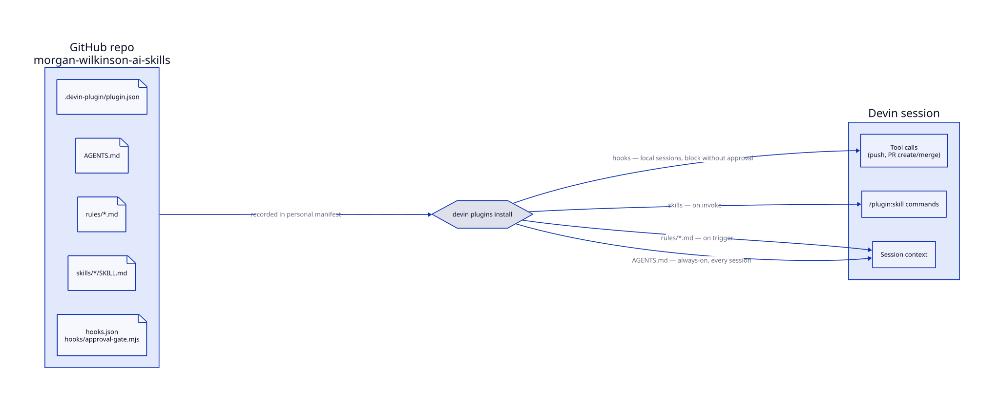

# morgan-wilkinson-ai-skills

A [Devin](https://devin.ai) plugin that ships personal rules and skills to every Devin session — CLI, Devin Desktop, and cloud sessions.



## What it contains

| Path | Type | When it applies |
|------|------|-----------------|
| `.devin-plugin/plugin.json` | Manifest | Plugin metadata; `name` is the `/<plugin>:` namespace |
| `AGENTS.md` | Always-on rule | Injected into the context of every session |
| `rules/coding-behavior.md` | Triggered rule (`model_decision`) | Loaded when the agent decides it is relevant |
| `skills/ui-ux/` | Skill | Available as `/morgan-wilkinson-skills:ui-ux`; invoked for UI work |
| `skills/changelog/` | Skill | Available as `/morgan-wilkinson-skills:changelog`; changelog templates, entry, pre-flight, and compile procedures |
| `hooks.json` + `hooks/approval-gate.mjs` | Lifecycle hooks | Local sessions (CLI, Devin Desktop); blocks `git push`, `gh pr create`, `gh pr merge`, and GitHub MCP PR/push tools unless the current user message contains "Approved" or "I approve" |
| `docs/diagrams/` | Documentation | `.d2` sources plus rendered `.svg` output |
| `scripts/validate.mjs` | Tooling | Structural validation, also run in CI |
| `scripts/test-approval-gate.mjs` | Tooling | Tests for the approval-gate hook, also run in CI |

## Install

```bash
devin plugins install Morgan-WIlkinson98/morgan-wilkinson-ai-skills
```

Installation is recorded in the personal plugin manifest in Devin Cloud, so the plugin loads on every signed-in machine and in cloud sessions.

For local development:

```bash
devin plugins install --local .
```

Local installs are linked to the source folder; edits apply on the next session without `devin plugins update`.

## Repository layout

```
.
├── .devin-plugin/
│   └── plugin.json           # plugin manifest
├── .github/workflows/        # CI: validate + render diagrams
├── changelog/unreleased/     # pending changelog entries (one file per change)
├── docs/changelog/           # archived changelog years
├── docs/diagrams/            # D2 sources + rendered .svg
├── hooks/                    # hook scripts referenced by hooks.json
├── rules/                    # triggered rules (frontmatter: description + trigger)
├── skills/                   # skills/<name>/SKILL.md + optional resources
├── AGENTS.md                 # always-on rules
├── CHANGELOG.md              # compiled changelog (entries merged to main)
└── hooks.json                # lifecycle hooks
```

## Approval-gate hook

`hooks/approval-gate.mjs` runs on two events:

- `UserPromptSubmit` — records, per session, whether the current message contains "Approved" or "I approve" (case-sensitive). State is stored under `$PLUGIN_DATA/approval-gate/` (falls back to the system temp directory).
- `PreToolUse` (`exec`, `mcp_call_tool`, `mcp__*`) — exits `2` (block) for gated actions unless the approval was recorded for the same `prompt_id`. Approval does not carry over to later turns.

Requires `node` on `PATH`. Plugin hooks are best effort and fail open: if the hook fails to load or run, the session continues without it, and the rules in `AGENTS.md` remain the primary control. Verify the hook is loaded with `/hooks` in a session.

## CI

- **Validate plugin** (`.github/workflows/validate.yml`) — on pushes to `main` and `dev` and every pull request: verifies `plugin.json` parses and has a valid `name`, `AGENTS.md` exists, `hooks.json` parses and its referenced scripts exist, every `skills/*/SKILL.md` has `name` + `description` frontmatter, and every `rules/*.md` has `trigger` + `description` frontmatter; then runs the approval-gate hook tests.
- **Check diagrams** (`.github/workflows/diagrams.yml`) — on pull requests and pushes to `main` and `dev` that touch `docs/diagrams/`: installs `d2` pinned to `v0.9.0` (SHA-256 verified), re-renders every `.d2` to `.svg`, and fails if the committed `.svg` files differ. It never pushes, so it works with the protected `main` branch.

## Development

All changes follow the workflow defined in `AGENTS.md`: GitHub issue → `feature/<description>` branch from latest `dev` → merged into `dev` without a pull request → `release/<yyyy-mm-dd>` branch cut from `dev` with the changelog compiled → pull request from the release branch into `main` → explicit human merge approval → `main` merged back into `dev`. Merging to `main` is the release — new sessions pick up the plugin at the latest commit on the default branch. Each change adds a Pending entry under `changelog/unreleased/`; see `docs/DEPLOYMENT-CHECKLIST.md` for the post-merge steps.

Diagrams are authored in [D2](https://d2lang.com/) under `docs/diagrams/`; render with `d2` `v0.9.0` and commit the `.svg` alongside the `.d2` source (CI fails if they are out of date). Do not use mermaid.

## License

MIT
